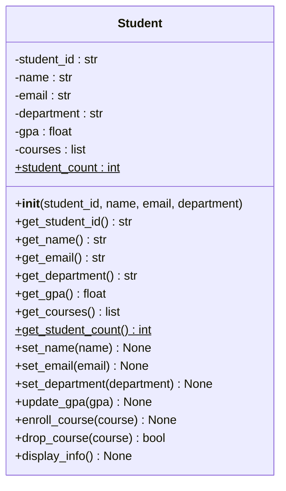

# AII003 - Student Class Diagram to Python Code

This repo maps a UML class diagram of a `Student` class into Python code.

## Class Diagram



## How the diagram maps to the code

| UML | Python |
|---|---|
| Class box `Student` | `class Student:` |
| `-` private attribute | attribute with double underscore, e.g. `self.__gpa` |
| `+` public method | normal method, e.g. `def enroll_course(self, course)` |
| Static (underlined / `$`) | class variable `student_count` and `@staticmethod get_student_count()` |
| Constructor | `__init__` |

- All attributes are private, so other code has to use the getters and setters (encapsulation).
- There is no setter for `student_id` because a student's ID shouldn't change.
- `update_gpa()` only accepts values between 0.0 and 4.0.
- `enroll_course()` doesn't add the same course twice.

## Files

- `student.py`: the `Student` class, plus a test part at the bottom that creates two students and tries every method

## How to run

```
python student.py
```

## Output

```
Ali Hassan is already enrolled in AII003 Principles of Software Engineering
Invalid GPA: 5.0 (must be 0.0 - 4.0)
Dropped AII406: True

ID: 20231001
Name: Ali Hassan
Email: ali.hassan@neu.edu.tr
Department: Computer Engineering
GPA: 3.45
Courses: ['AII003 Principles of Software Engineering']
---------------------------
ID: 20231002
Name: Sara Ahmed
Email: sara.a@neu.edu.tr
Department: Software Engineering
GPA: 3.8
Courses: ['AII003 Principles of Software Engineering']
---------------------------
Total students: 2
Can't access s1.__gpa directly, use s1.get_gpa() instead: 3.45
```
